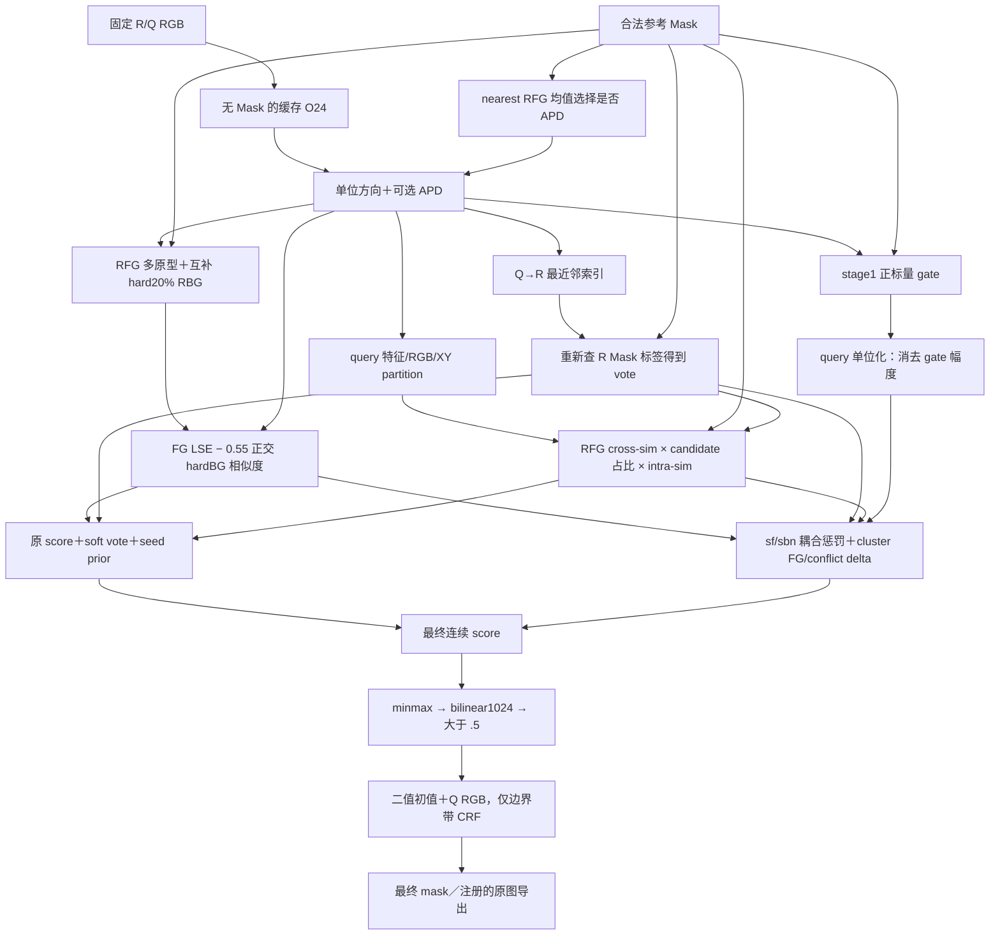

# 参考 Mask 到有效查询读出：五域既有证据

2026-10-11，独立只读审查。**统一低成本方案需要保留的能力是：真实查询判别消费合法参考正／负证据，控制其余背景和预测面积，保住已有正确覆盖，并让被融合否决的区域仍有可用参考旁路。现有证据没有支持一个跨五域统一的“首次不可恢复位置”。**

标量 gate 的一个条件通道确实几乎消失，但 FoRIS 后续仍多次重新读取参考 Mask。查询 partition 不随 Mask 改变，也不等于其上的权重和背景惩罚不随 Mask 改变。二值化后 CRF 没有参考输入；当前 C→N 又明确禁止恢复 C 删除的原 FoRIS 前景。这些是可定位的局部能力边界，不能合并成“DINO不理解任务”或“所有任务信息在同一层消失”。

证据收据：[path_evidence.json](/Users/misaya.yanghejazfs.com.au/paper_project/cv_reasearch/evidence/local/five_dataset_effective_readout_20261011/path_evidence.json)，SHA `2130502b347e42630a38a45f5808e2a3fc7016ebe406c7225e96adeb9fb8bd9e`。官方实际源码 SHA `982cf4aa91ac90370151c353efb37240d7d4d5c35a0dfe9cc9509cd554c85fa9`，与原60对配置完全一致。收据绑定34个代码锚点、既有干预、五域正负整数例；本轮0模型／raw／GT或annotation／field或mask读取，0fit、score、bootstrap或新预测。

## 有效路径及参考旁路

这里 source 参数中的 `raw target` 指 **gate前、可能已经APD后的** `fmaps_norm`，并非自动跳过APD的原始DINO特征。实际编码只收 RGB，[predict:178](/Users/misaya.yanghejazfs.com.au/paper_project/cv_data/third_party/foris_official/models/foris.py:178) 没有 Mask 输入；固定 RGB 编码相同是模型契约，任务解释发生在后面的参考条件读出。

|实际读取／判断|代码位置|改变什么；旁路是否存在|
|---|---|---|
|参考栅格与APD|[Mask raster:130](/Users/misaya.yanghejazfs.com.au/paper_project/cv_data/third_party/foris_official/models/foris.py:130)、[APD:304](/Users/misaya.yanghejazfs.com.au/paper_project/cv_data/third_party/foris_official/models/foris.py:304)|nearest Mask 的RFG均值与Q均值决定是否应用固定位置投影；不是学习一个Mask条件矩阵。60对只有3对A/B切换APD；raw/apd前缀差不足以证明投影为统一首次损失。|
|FG与hard BG|[prototypes:382](/Users/misaya.yanghejazfs.com.au/paper_project/cv_data/third_party/foris_official/models/foris.py:382)、[stage2:485](/Users/misaya.yanghejazfs.com.au/paper_project/cv_data/third_party/foris_official/models/foris.py:485)|Mask选择FG和互补BG；BG取与FG均值最像的20%，FG做聚类多原型。stage2重新读bilinear>.5/fallback Mask，正交BG后直接进入查询负项。默认BG权重实际为 **.55**，见[defaults:33](/Users/misaya.yanghejazfs.com.au/paper_project/cv_data/third_party/foris_official/models/foris.py:33)，cached host未覆盖。|
|gate局部消去|[gate:453](/Users/misaya.yanghejazfs.com.au/paper_project/cv_data/third_party/foris_official/models/foris.py:453)、[raw bypass:474](/Users/misaya.yanghejazfs.com.au/paper_project/cv_data/third_party/foris_official/models/foris.py:474)、[reference bypass:539](/Users/misaya.yanghejazfs.com.au/paper_project/cv_data/third_party/foris_official/models/foris.py:539)|gate≥.1；默认stage2查询score/cluster、stage3均用gate前特征，stage2参考原型也用gate前R。stage4将gated Q单位化，正标量不改变方向。FG/BG、vote、RFG seed仍是旁路。|
|NN投票|[NN labels:588](/Users/misaya.yanghejazfs.com.au/paper_project/cv_data/third_party/foris_official/models/foris.py:588)|Q先匹配所有R token，再查最近R位置的Mask标签；不是仅匹配FG。`ref_prototype`形参没有参与这段计算。投票以soft加分进入score，没有把所有非candidate像素直接清零。|
|query partition／RFG seed|[partition:640](/Users/misaya.yanghejazfs.com.au/paper_project/cv_data/third_party/foris_official/models/foris.py:640)、[R reentry:654](/Users/misaya.yanghejazfs.com.au/paper_project/cv_data/third_party/foris_official/models/foris.py:654)、[densify:729](/Users/misaya.yanghejazfs.com.au/paper_project/cv_data/third_party/foris_official/models/foris.py:729)|partition主要来自Q方向、RGB、XY；种子选择和cluster prior重新读取RFG均值和Mask条件vote。另加入25%规则网格candidate，因此缺正NN票也不是整条路径不可恢复。|
|semantic背景控制|[penalty:772](/Users/misaya.yanghejazfs.com.au/paper_project/cv_data/third_party/foris_official/models/foris.py:772)、[cluster delta:805](/Users/misaya.yanghejazfs.com.au/paper_project/cv_data/third_party/foris_official/models/foris.py:805)|partition可相同，但输入sf/sbn、vote、prior仍由合法Mask条件化。FG/BG共同高响应产生惩罚；cluster FG纯度／冲突均值产生有界加减项。相同cluster内delta不改变像素排序，原unary仍保留。|
|二值读出／CRF|[binarize:247](/Users/misaya.yanghejazfs.com.au/paper_project/cv_data/third_party/foris_official/models/foris.py:247)、[CRF:60](/Users/misaya.yanghejazfs.com.au/paper_project/cv_data/third_party/foris_official/utils/refinement.py:60)|不再重新读取R。CRF输入是二值初值和Q RGB，远离FG膨胀边界的outside core明确保持False，inside core保持True；它不能在远处重新识别指定目标。|

FG／BG的两种Mask token化不能画成同一数组：[downsample_mask:43](/Users/misaya.yanghejazfs.com.au/paper_project/cv_data/third_party/foris_official/utils/data.py:43) 是bilinear>.5、空时nearest、再空则前景质心token；APD/gate是nearest。原60对这两种hard Mask均无A/B碰撞，但不能据此排除其它小目标的栅格损失。

## 双任务响应与其余背景必须分开

原60对COCO/PACO/SUIM各20张不同查询，A/B固定R/Q RGB和crop，切换两个真实合法参考任务，另有等面积shift阴性控制。其I/U与以下任务均值是**完整canonical1024 CRF输出的每照片两任务均值**，不是五域官方mIoU或原图指标；[原评分帧:391](/Users/misaya.yanghejazfs.com.au/paper_project/cv_reasearch/scripts/opus55_reference_mask_trace.py:391) 明确如此。已有验证10749项、40个原任务score逐位复现，本轮只引用。

|域|A/B switch-AUC，APD FG/BG→最终CRF|Q当前目标／所有非目标AUC，FG→FG/BG|最终FP中其余背景占比|
|---|---|---|---:|
|COCO|.9042→.8620|.9473→.9666|88.9%|
|PACO-Part|.8911→.8117|.9121→.9169|69.1%|
|SUIM|.8423→.7819|.7623→.8802|62.9%|

switch-AUC只比较A/B独占区域；目标／全部非目标role-AUC和其余背景统计分别来自已完成的`role_transfer_audit`、`role_audit`。其余背景包含所有非当前任务、非另一个任务像素，不能称全是未见类别。原最终mask内部FG／FP AUC仅.718/.741/.696，比全图双任务身份AUC更接近现实误报问题。

hardBG平均改善Q角色排序，但3/8/5个任务的BG方向AUC<.5，R正确BG margin而Q反向为2/5/4个任务。它支持“需要有效负证据及迁移检查”，不支持原hardBG在每个查询都正确。上表来自冻结场的代数对照／诊断，**不是移除hardBG再运行完整流水线的因果收益**。

## 已完成干预能说明到哪一层

|证据及等级|已保存结果|对统一方案的实际约束|
|---|---|---|
|去scalar gate，同输入算子干预|118/120任务完整CRF mask逐位相同；另两任务共252+11个像素差，单位方向最大误差3.87e−7。|确有局部条件通道近乎消去；后续R原型／标签／seed旁路仍在，不能宣称全任务信息在gate首次不可恢复。|
|去additive delta，完整输出因果干预|完整两任务IoU点差COCO−.7715、PACO−.3719、SUIM−.2651pp，三域区间均跨0。|连续switch-AUC下降的末尾算子仍可能帮助完整背景读出；不能从轨迹下降推出“删掉即修复”。|
|固定task-axis下query membership，同输入因果干预|FG/BG/vote保持逐位相同；task-axis−固定partition的IoU增量+.320/−.656/−.598pp，区间均跨0。PACO改善不必换partition；SUIM损失也未消失。|不能把partition标签是否改变当有效任务判别；需检查已有group上合法参考权重和局部残差。|
|方向metric完整干预及参考拟合关联|task轴对native完整IoU+.749/+3.124/−1.987pp；R拟合改善而Q变差49/120任务。|参考自洽或方向响应不保证查询迁移，也不支持域名selector。|
|排序／分布交换，固定score读出干预|PACO候选+3.780pp；保原排序换候选分布+3.042，换候选排序保原分布仅+.126。COCO/SUIM也保留反例。|需同时验证空间排序和阈值后的预测面积；不能将分布／面积收益包装为新增身份能力，点差也不可线性分摊。|
|原极值桥完整读出干预|COCO−1.301、PACO+5.646、SUIM−3.242pp。|统一保原min/max不是跨域修复。|
|GT最优双任务阈值，上界诊断|身份AUC上界改善，但FP/GT从.294/.508/.252扩大到1.057/.931/.548，完整IoU有反例。|A/B识别和其余背景精度是不同要求；oracle阈值不是合法部署规则。|

所有记录路径、原seal和验证SHA绑定于收据的`source_files_sha256`、`mask_only60`。算子由已曝光60对选择，均不是未见照片确认。没有新增APD删除、hardBG删除、semantic penalty删除或CRF删除实验；这些位置的独立最终因果贡献仍未知。

## 五域6200：当前融合的恢复能力与反例

当前atlas保留完整FoRIS=B、MEAN=G、bounded reference ridge host=R0，C为三者多数；N只增加被C拒绝的mean-only参考支持：

`C=(B&R0)|(B&G)|(R0&G)`；`N=C|((~B)&(~R0)&G&(H>0))`。

MEAN自身不是裸参考头：[mean_control:18](/Users/misaya.yanghejazfs.com.au/paper_project/cv_reasearch/src/ics/methods/mean_control.py:18) 以合法RFG guide修正**完整FoRIS score**的rank，并作Q图平滑，继承了FoRIS背景处理。R0用合法R soft FG/BG目标拟合、参考held-out阈值／分离度得到bounded H，同时以B的符号／confidence保护已有终点；[ridge readout:141](/Users/misaya.yanghejazfs.com.au/paper_project/cv_reasearch/evidence/local/parallel_signal_20261010/02_task_identity/ridge_coco_validation/run.py:141) 明确如此。H清零只令新增ridge分支失效，R0=B、C=N=B；其它参考通道没有随之全部消失。

**旧6200在每个frame直接布尔组合，CLI和original都成立`N&B=C&B`。** 2380路径在[每帧解包与shape:164](/Users/misaya.yanghejazfs.com.au/paper_project/cv_reasearch/scripts/sol_supported_foreground2380_v2.py:164) 分别用B/R/C/G和该帧H计算N；native4000在[逐帧调用:179](/Users/misaya.yanghejazfs.com.au/paper_project/cv_reasearch/scripts/sol_native4000_compose.py:179) 直接取`parents[frame]`再执行[frame_readout:48](/Users/misaya.yanghejazfs.com.au/paper_project/cv_reasearch/scripts/sol_native4000_compose.py:48)。它不是1300新三臂的整张canonical统一导出链，不能混用渲染边界。

N保留H/G旁路，能恢复C遗漏的部分G-only目标；但它不能恢复任何C已经删除的原B前景，也不能凭空恢复G都没有的区域。这是当前**布尔工作图的准确恢复排除条件**，不是上游原型或编码已无信息的证据。

下表沿主Sol已冻结的每域最大正／负官方class贡献及对应例，直接引用original整数；不再读图、annotation、mask或GT。ΔTP/ΔFP是N相对FoRIS总整数差，不能当新像素四编辑或上游算子因果归因。

|域／既有例ID尾部|FoRIS→N IoU|ΔTP|ΔFP|N−C (TP,FP)|能约束的读出能力|
|---|---|---:|---:|---|---|
|COCO 1/13 正|64.127→82.651|−450|−15566|(0,0)|主要由C降低FP；不能归功N旁路。|
|COCO 1/36 负|16.677→12.931|−4208|−9001|(0,0)|删FP同时丢覆盖，N无法恢复B删除区。|
|PACO 1/75 正|26.756→63.351|−40|−2982|(0,0)|背景删除有效，但MEAN84.046更高；多数仍有保真代价。|
|PACO 0/29 负|43.878→27.931|−4817|−1656|(0,0)|FP减少不足抵消TP损失。|
|LVIS 8/82 正|8.663→66.624|−11|−5359|(0,0)|小GT下大量原FP下降；不是任务表征恢复证明。|
|LVIS 2/105 负|61.983→14.418|+3|+420|(0,+6)|目标覆盖增加伴随大FP；N进一步只加6个FP。|
|PASCAL 2/63 正|22.625→48.864|−2|−315|(0,0)|R0／C改善背景，MEAN仅4.698；不能统一替换强参考头。|
|PASCAL 1/178 负|32.583→20.501|−171|−22|(0,0)|共同删错且无恢复旁路进入B删区。|
|SUIM −1/1873 正|47.898→62.626|+20|−354|(+22,+7)|N确有补真，但同预算K63.388更好，支持位置不是自动正确。|
|SUIM −1/428 负|79.866→48.772|−40097|−94|(0,0)|B TP102875→C=N62778；既有正确覆盖大量丢失，N的排除条件阻止恢复。|

atlas6200并非五域Mask-only试验：只有PASCAL一个同R/Q实际RGB、crop、尺寸而异Rmask的两任务组（3/312与3/422）。二者N−C分别增加1100TP/80FP、83TP/182FP，是任务间正／负权衡；不同GT的I/U差本身不证明预测跟随Mask。未重新计算该组switch-AUC。原60对A任务与atlas有严格输入重叠的仅COCO20、PACO20；SUIM旧trace没有相同实际输入行，LVIS和PASCAL没有60对逐阶段因果轨迹。收据明确保留这些范围，不能把三域干预包装成五域因果结论。

## Pro200提供的反证及必要能力

Pro的whole `global_repeat` 在任何配准／重建前就只有Deep11.1403、PACO29.6173；对应FP为29933545、913840。重建后11.4994/29.6576仍远低于同批完整FoRIS29.3775/45.5639。所有六臂共享[role_bank/role_margin:168](/Users/misaya.yanghejazfs.com.au/paper_project/cv_reasearch/evidence/local/nine_window_execution_20261011/pro_scene_adapter/src/scene_reconstruction.py:168) 的合法RFG/BG面积加权KDE和严格零margin读出；其[global_repeat:228](/Users/misaya.yanghejazfs.com.au/paper_project/cv_reasearch/evidence/local/nine_window_execution_20261011/pro_scene_adapter/src/scene_reconstruction.py:228) 足以证明弱头问题已在重建前存在。

Pro没有FoRIS的hard20% BG／正交负方向、Mask标签vote／seed、sf/sbn耦合与semantic修正、FoRIS阈值／CRF链；其APD和renderer也不同。因此这不是删掉某一个FoRIS BG算子的干预，**不能用Pro失败定位原FoRIS失真，更不能把raw配准／coarse守恒成功称任务迁移成功**。主Sol独占registration等receipt标量，本线没有重复分析。

对统一低成本方案应保留以下能力，而不是强制照搬全部模块：

- **有效正／负参考判别。** 真实查询score必须消费合法RFG和有信息的RBG；在稀有任务、部件和大面积region上验证对全部非目标的迁移。R自拟合、partition改变、feature对齐不能替代这一点。
- **背景与面积约束。** 用完整FoRIS／MEAN原图终点检验误报，保持当前目标、另一个真实目标、其余背景三类定义；排序改善必须经实际阈值和完整输出仍成立。
- **覆盖保护及合法恢复旁路。** 允许已有参考证据改变被否决区域，而非只用最终多数mask决定是否还有恢复资格。既有C删除B前景且N不可恢复的限制，以及H无效后所有新增动作关闭，必须明示。
- **区分必要能力与多余通道。** 已因果验证的scalar幅度gate近乎冗余；参考prototype、hardBG、Mask标签vote和reference-weighted cluster读出仍有效。当前证据不足以整体删掉后者或宣称固定partition无用。

可以准确定位：gate幅度这一支被消去、invalid H中和这一新增支、二值化／CRF的远区恢复支持受限、C→N的B前景恢复禁区。**不能据现有证据定位跨五域、整条任务判断的第一次不可恢复损失。** 当前交付没有新增算法、训练头、参数、队列或运行前提；九窗与Pro变体均关闭，后续完整方案由主Sol／设计线按新的人类授权决定。

## 小范围补充：单个 hard64 Mask 不是完整压缩切点

**反驳“所有参考依赖都经过同一个 `downsample_mask` hard64 数组”。** 固定原FoRIS实际使用两个不同的64×64角色数组。令先经`set_reference` nearest得到的1024二值Mask为M，`N64=nearest(M,64)>.5`，`D64=downsample_mask(M,64,64)`。D64先bilinear>.5，空时nearest，再空时质心回退；N64没有该回退。二者不能互相替代。

|入口到最终返回值的Mask依赖|实际压缩输入|是否还有原像素Mask的有效读取|
|---|---|---|
|`set_reference`→RGB encoder|M在[130–137行](/Users/misaya.yanghejazfs.com.au/paper_project/cv_data/third_party/foris_official/models/foris.py:130)独立nearest栅格化；encoder只收RGB|同R RGB/crop/encoded输入、固定Q时，编码不由Mask改变。|
|`_should_apply_positional_debias`|**N64**，[304–338行](/Users/misaya.yanghejazfs.com.au/paper_project/cv_data/third_party/foris_official/models/foris.py:304)|按N64选RFG均值，决定是否投影整个R/Q；不读原Mask面积或连续coverage。|
|`_part2_stage1_feature_gating`|**N64**，[430–459行](/Users/misaya.yanghejazfs.com.au/paper_project/cv_data/third_party/foris_official/models/foris.py:430)|按N64构造FG/hardBG和reference gate floor；gate幅度仍可通过float32的stage4单位化／聚类舍入造成微差。|
|stage2 FG/BG、NN proposal标签、seed RFG均值|**D64**，[485–493](/Users/misaya.yanghejazfs.com.au/paper_project/cv_data/third_party/foris_official/models/foris.py:485)、[591–592](/Users/misaya.yanghejazfs.com.au/paper_project/cv_data/third_party/foris_official/models/foris.py:591)、[656–659](/Users/misaya.yanghejazfs.com.au/paper_project/cv_data/third_party/foris_official/models/foris.py:656)|此固定1024／O24入口各自重复同一个64网格压缩；不继续消费原Mask边界、面积或coverage。质心仅决定D64的回退位置，D64相同后无另一个质心输出。|
|sf/sbn、query partition/prior、semantic correction|R/Q经APD与gate后的特征，以及由N64/D64生成的分数／标签|无新的原像素Mask读取；Mask影响沿上述派生量传播。|
|binarize→CRF→`segment`返回|最终score、二值初值、Q RGB／固定尺寸|无参考Mask、GT2D或连续coverage旁路。`set_target`的gt_mask在[152行](/Users/misaya.yanghejazfs.com.au/paper_project/cv_data/third_party/foris_official/models/foris.py:152)明确忽略。|

因此，**只知道D64相同，不足以推出原FoRIS最终判断相同**：N64可能不同，RFG均值可令APD开关不同，进而改变整个R/Q方向以及其后的sf/sbn、proposal和prior。两种采样算子不同，源码没有给出N64是D64函数的关系。这里是源码依赖反驳，没有构造或运行一对新的自然任务反例。

即便D64相同且APD开关相同，默认raw score／clustering路径确实旁路stage1 gate，且理想实数单位化消去正gate；但机器float32的semantic聚类仍可能变化。既有gate删除120任务中两任务出现252／11像素差，说明不能把这个理想恒等式升格为严格机器输出相等；它也不证明自然D64别名恰发生在这两任务。

**可给出的条件性相等证明是联合签名 `(N64,D64)`，不是D64单签名。** 假定同一有序参考集合／S、同R RGB/crop/encoder tensor、同固定Q RGB/encoder tensor/尺寸、同native positional basis、参数和host初态；同时固定随机状态、dtype/device/threading，并要求聚类／CRF等数值执行对相同输入确定。若每个参考的N64和D64分别逐位相同：

1. APD按相同N64读取相同R/Q特征，得到相同开关与投影结果。
2. gate按相同N64得到相同原型／floor／幅度；stage2按相同D64得到相同FG/BG多原型、sf/sbn与score。
3. NN索引相同、D64标签相同；query partition和reference-weighted seed输入相同，故vote／prior相同。
4. penalty和semantic delta接收相同特征／分数，最终score、binarize与CRF输入相同，最终预测mask相同。

这可写为`prediction=Φ(fixed R/Q inputs, basis, parameters, state, N64, D64)`。联合签名是该固定入口的**充分**别名条件，不是必要条件；仅固定随机seed也不能替代数值确定性假定。

没有漏掉的原面积／shape／连续coverage路径：原Mask形状只参与首次1024栅格化和D64内部回退；原FoRIS后续不直接读取其面积或软质量。60轨迹的`reference_coverage=avg_pool2d(...)`在[原final返回之后的321行](/Users/misaya.yanghejazfs.com.au/paper_project/cv_reasearch/scripts/opus55_reference_mask_trace.py:321)保存，只用于诊断；`run_foris`另外返回的完整`mask_model`也是观察量，可能不同，证明只针对**预测mask**，不宣称整个诊断返回tuple相同。

源码仍绑定官方SHA `982cf4aa91ac90370151c353efb37240d7d4d5c35a0dfe9cc9509cd554c85fa9`和[cache_host:98](/Users/misaya.yanghejazfs.com.au/paper_project/cv_reasearch/scripts/cached_dino.py:98)原参数；没有更换source或执行Mask重放。自然D64／联合签名别名库存由signals唯一核算，本补充不声称五域自然别名已经发生或已形成修复算法，也不将此cut外推到使用soft coverage的MEAN／ridge／C/N其它分支。
